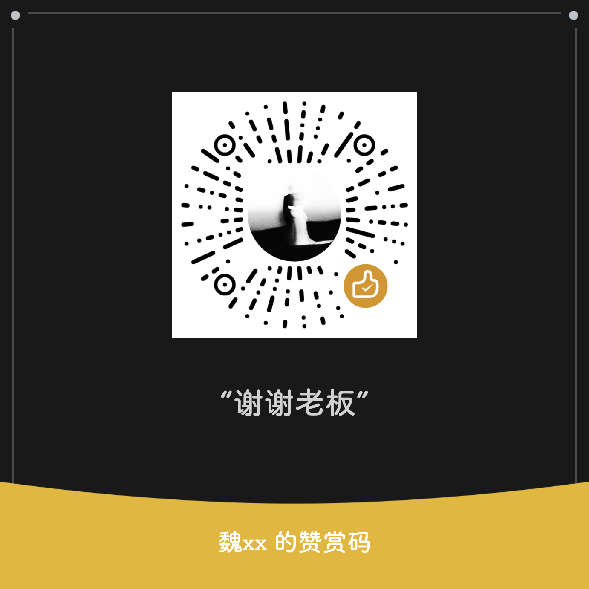

# taplusbridge

传送门 4.1.3 / 40013、5.1.5 / 50015 的 libxposed API 102 模块。当前正式版：**0.15.53 / 85**。

[下载最新版](https://github.com/Xposed-Modules-Repo/io.github.yudigaga.taplusbridge/releases/latest) · [使用指南](https://github.com/yudigaga/TaplusBridge/blob/main/docs/usage.md) · [本次更新](https://github.com/yudigaga/TaplusBridge/blob/main/docs/release-notes-0.15.53-release.md)

## 功能

- 按域名、网址或 magnet / ed2k 协议规则交给目标应用，支持 Root / Shizuku 解冻目标。
- 长按识别、截图兜底、补充取链与四方向拖动；拖动后的动作复用本轮内容和有效链接。
- Google Lens 同图会话识图、独立浏览器设置、本机翻译应用或 AI 替换翻译。
- 剪贴板链接入口、下载链接多选分组及分享；应用名单与识别通道可单独配置。
- 模块按需运行，支持隐藏桌面图标；隐藏后从 LSPosed 模块设置进入并恢复。

## 安装

1. 安装 Release APK，在 LSPosed 启用模块，勾选「传送门／内容扩展」和「系统框架」。
2. 重启手机，打开模块，确认「系统已确认配置」。
3. 在「应用」页配置生效名单，在「规则」页设置目标应用与链接规则，再按需开启识别通道与拖动操作。

使用来源原生选字工具条的浏览器／APP 翻译接管时，还需在 LSPosed 额外勾选对应来源应用，并结束、重启该应用。它不是所有来源页面的通用接管：APP 翻译目前仅覆盖符合条件的原生 TextView 浮动选区。模块识别与来源菜单协调仍只需前述两个基础作用域。

覆盖安装后也应重启并确认配置。Google Lens 需要可访问 Google 的网络。实际可取内容由来源应用提供，无法保证还原全部隐藏链接；设备上的 Hook、ROM 菜单交接和真实服务仍需验收。

## 本次更新

0.15.53 等待同一次手势的有效抬手，持按达到识别阈值后才尝试关闭本轮来源菜单。系统确认来源应用正在录音时，会跳过宿主首次识别呈现和长按拖动准备及交接。

归档验证包含 1,957 项 Android 单测和 73 项 Python 测试，Release lint 为 0 错误、32 条警告。发布前复核了长期 v2 签名和 16 KiB 对齐。真实录音及 ROM 手势仍需设备验收。[构建与发布核验](https://github.com/yudigaga/TaplusBridge/blob/main/docs/2026-11-19-release-0.15.53.md)

## 项目文档

- [源码与文档索引](https://github.com/yudigaga/TaplusBridge/blob/main/docs/README.md)
- [问题反馈](https://github.com/yudigaga/TaplusBridge/issues)

## 赞助

如果喜欢这个项目，欢迎请我喝杯咖啡 ☕

