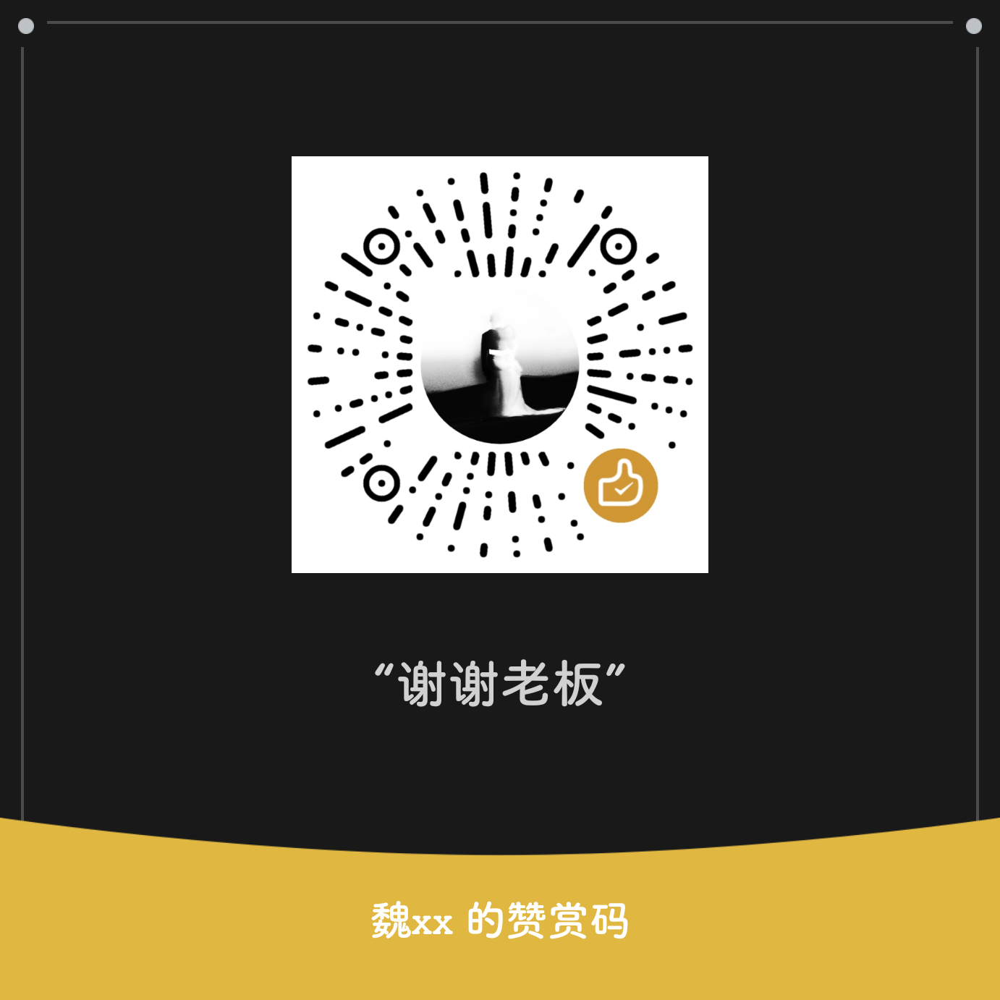

# taplusbridge

当前正式版：0.15.43 / 75。改善长按识别和拖动响应，修复配置保存一致性，完善截图与 Lens 任务取消及按需缓存。

面向传送门 4.1.3 / 40013 和 5.1.5 / 50015 的 libxposed API 102 模块。按链接规则把识别到的网址交给指定应用打开，支持冻结目标的 Root 或 Shizuku 解冻。

## 功能

- 域名、网址及 magnet: / ed2k: 协议规则，目标应用名称和图标
- 冻结目标解冻后打开，支持 Root / Shizuku
- 模块本体保持启用，移除冻结本体专用通道；任务、会话、编辑和待交付内容结束后按需释放后台进程
- 可在「概览 → 运行与授权」隐藏桌面图标，从 LSPosed 模块设置进入并恢复
- 在线规则，以及生效应用黑名单 / 白名单
- 可选截图识别兜底与长按取链（默认关闭）
- Google Lens 识图：自动上传、原生半屏 / 全屏结果，同一图片会话内搜索与切换模式
- 四方向拖拽操作：按方向配置识图、翻译、分享或规则打开（默认关闭）
- 设置页分为概览、识别、应用、规则四页，支持点选和横向滑动
- 识别通道及补点开关独立即时保存，并显示系统配置确认状态
- 可选本机翻译应用或 AI 替换翻译
- 剪贴板链接规则入口与下载链接多选分组；115 批量直达离线添加，任务由用户提交
- 长按取链明确结束后及时执行后续动作，复制与翻译使用已有正文；保留用户设置的手势阶段时长
- 保存失败恢复已确认配置，截图传输有总时限，Lens 旧会话与页面任务及时取消

## 安装

1. 安装 APK
2. 在 LSPosed 中启用模块
3. 勾选「传送门」和「系统框架」作用域
4. 重启手机
5. 在模块中添加目标应用和域名；按需在「生效应用」配置名单和开关

## 使用

长按内容触发传送门，点击显示目标应用图标的卡片打开。不需要为目标应用逐个编写适配。Google Lens 识图需要可访问 Google 的网络。

覆盖安装后请重启，并保持模块启用及上述作用域；在模块内等待系统确认配置。隐藏图标后，可从「LSPosed → 模块 → taplusbridge → 模块设置」进入并恢复。图标刷新时间及进程回收表现取决于实际桌面和 ROM。

0.15.43 发布前完整 Android 本地单测 1442 项、Python 两处共 67 项通过，lint 0 错误、29 条警告；长期 v2 签名与 16 KiB 对齐通过。真机 LSPosed、ROM、管道与真实服务验收仍未执行。

## 链接

- [源码](https://github.com/yudigaga/TaplusBridge)
- [问题反馈](https://github.com/yudigaga/TaplusBridge/issues)

## 赞助

如果喜欢这个项目，欢迎请我喝杯咖啡 ☕

